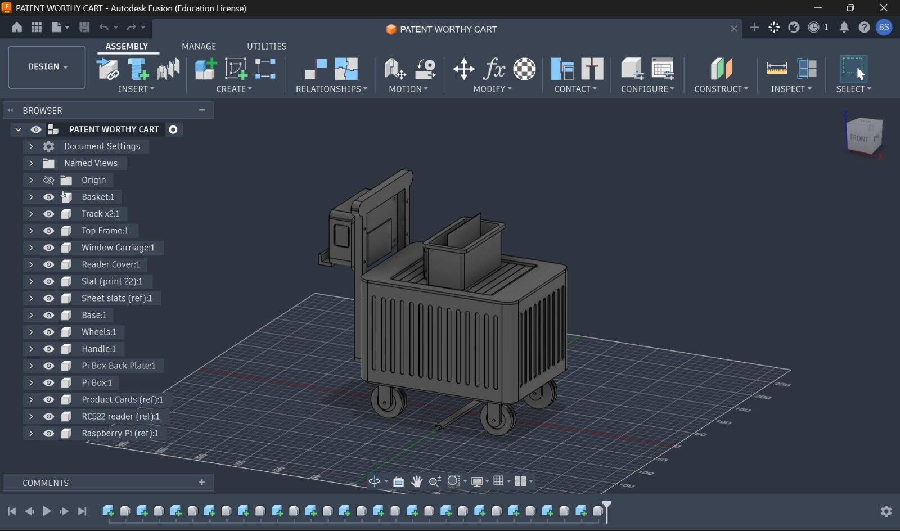
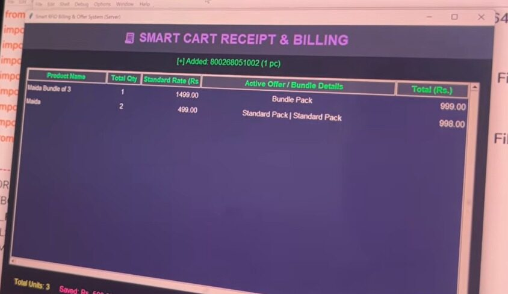
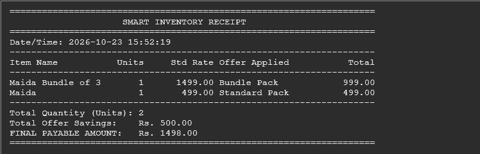
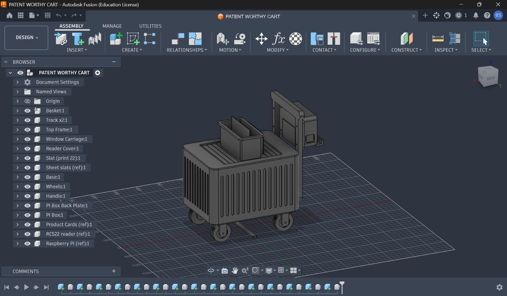
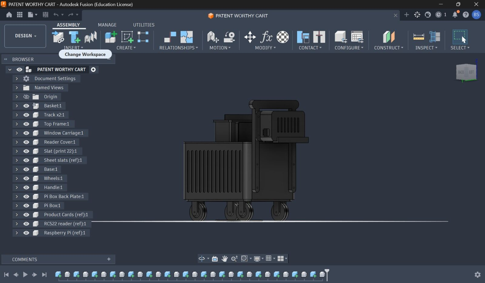

# RFID Smart Billing Cart

A shopping-cart prototype that bills items automatically. Items are tagged with RFID cards. The reader scans each one as it goes into the cart or comes out, and the bill updates live. This was a team course project, completed in October 2026.

▶ **[Watch the CAD walkaround](cad-walkaround.mp4)**

## How it works
- **Controller:** a Raspberry Pi 3B+ runs the system, with an RC522 RFID reader.
- **Scanning:** products are RFID tags or cards. Each scan adds the item to the bill, or removes it.
- **Billing app:**
  - Shows quantities, standard rates and active offers (bundle packs).
  - Calculates savings and generates a receipt.
  - Includes a product and offer manager.
- **Lid:** once the bill is paid, the cart's lid slides open.
- **Cart body:** designed in Fusion 360 to be 3D-printable. The model includes the basket, sliding window carriage, reader cover and Pi enclosure.

| Billing app | Receipt |
|---|---|
|  |  |

| Back view | Side view |
|---|---|
|  |  |

## Team

